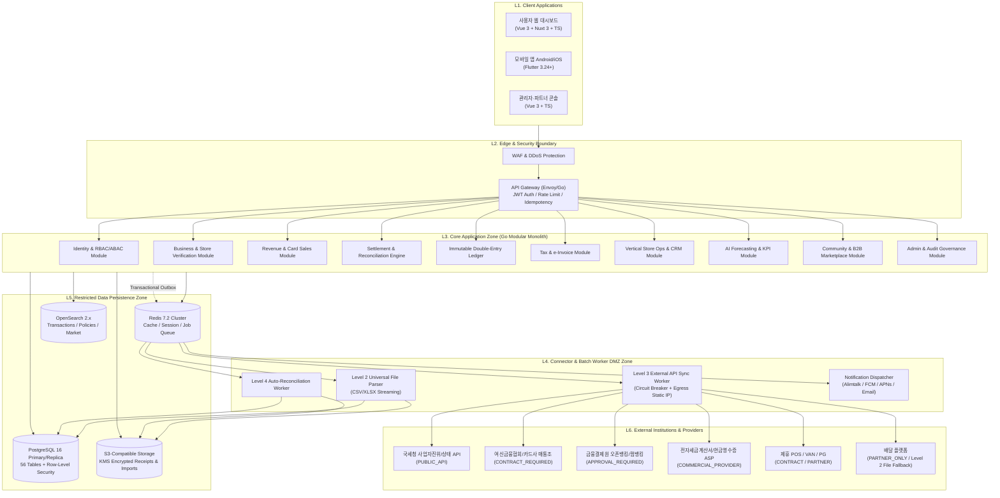

# 컴포넌트 구조 및 도메인 경계 다이어그램 (Component Diagrams)

**문서 ID**: ARCH-COMP-002  

---

## 1. 전체 컨텍스트 및 컨테이너 아키텍처 (Mermaid C4 Diagram)

---

## 2. Go 백엔드 내부 패키지 의존성 규칙 (Strict Package Layering)

순환 참조(Circular Dependency)와 도메인 오염을 막기 위해 Go 모듈(`github.com/booking-network/bn-merchant-os`) 내부는 단방향 의존성만 허용한다:

1. `internal/platform/*` (Config, Logger, Telemetry, KMS Crypto, DB RLS Tx Wrapper, Clock, HolidayCalendar) — 최하위 기반 계층
2. `internal/identity/*` 및 `internal/business/*` — 테넌트(`business_id`, `store_id`) 및 권한 검증 계층
3. `internal/ledger/*` — 불변 복식부기 원장 코어 (Revenue, Expense, Tax, Marketplace 모듈이 이벤트를 통해 전표를 발행)
4. `internal/connector/*`, `internal/revenue/*`, `internal/expense/*`, `internal/tax/*`, `internal/operations/*`, `internal/crm/*`, `internal/ai/*`, `internal/commerce/*` — 비즈니스 도메인 계층
5. `internal/admin/*` 및 `cmd/api-server`, `cmd/connector-worker` — 최상위 조합 및 엔트리포인트 계층
