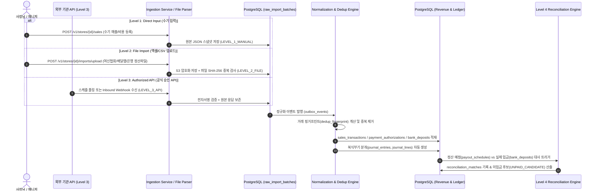

# 4단계 데이터 수집 및 카드 매출·정산·대사 데이터 흐름도 (Data Flow)

**문서 ID**: ARCH-DATAFLOW-003  

---

## 1. 제4조 4단계 데이터 수집 파이프라인 (Level 1 ~ Level 4)

모든 외부 및 내부 데이터는 수집 경로와 무관하게 **단일 정규화 파이프라인(Canonical Normalization Pipeline)**을 통과하며, 원본 배치 추적성(`raw_import_batch_id`)과 출처 등급(`source_level`)을 유지한다.

---

## 2. 제7조 & 제8조 카드 거래 6단계 생명주기 상태 전이

| 단계 | 상태 코드 | 기준 금액 컬럼 | 회계 분개 (자동 생성) | 비고 |
|---|---|---|---|---|
| **Stage 1. 승인** | `AUTHORIZED` | `authorized_amount` (공급가+부가세+봉사료) | 메모 기장 또는 매출 인식 시점 정책에 따라 외상매출금/카드미수금 가집계 | 승인 후 즉시취소(`VOIDED`) 시 상계 |
| **Stage 2. 매입** | `CAPTURED` | `captured_amount` | `[차] 카드미수금 + [차] 카드수수료(예상) / [대] 카드매출 + [대] 부가세예수금` | 전표 매입 확정 |
| **Stage 3. 수수료 산정** | `FEE_CALCULATED` | `fee_amount` (기본+포인트-우대환급) | 수수료 차액 발생 시 수수료 계정 보정 | 카드사별·우대등급별 요율 적용 |
| **Stage 4. 지급 예정** | `SETTLEMENT_SCHEDULED` | `net_settlement_scheduled_amount` | `payout_schedules` 생성 (카드사별 D+2/D+3 영업일 반영) | 매입후취소 발생 시 차기 지급예정액에서 차감 |
| **Stage 5. 은행 입금** | `BANK_DEPOSITED` | `actual_bank_deposit_amount` | `bank_deposits` 수집 (오픈뱅킹 API 또는 통장 엑셀) | N건 거래가 카드사별 일별 1건으로 합산 입금됨 |
| **Stage 6. 입금 대사** | `RECONCILED_MATCHED` / `UNPAID_CANDIDATE` | `variance_amount = scheduled - actual` | `[차] 보통예금 / [대] 카드미수금` (차액 발생 시 미수금 잔액 유지 및 경보) | 데이터 수집 지연 시 `SYNC_DELAY_PENDING`으로 분리 |
