# BN Merchant OS 전체 데이터베이스 ERD (Entity-Relationship Diagram)

**문서 ID**: DB-ERD-001  
**대상 DBMS**: PostgreSQL 16 (`03_DATABASE/migrations/0000_full_schema.sql` 10개 도메인 56개 전체 테이블)

---

## 1. 핵심 도메인 간 관계 다이어그램 (Mermaid ERD)

```mermaid
erDiagram
    users ||--o| user_profiles : "has"
    users ||--o{ identities : "authenticates_via"
    users ||--o{ sessions : "maintains"
    users ||--o{ businesses : "owns"
    businesses ||--o{ business_verifications : "verified_by"
    businesses ||--o{ stores : "operates"
    stores ||--o{ store_members : "grants_access"
    roles ||--o{ store_members : "assigned_to"
    store_members ||--o{ store_permissions : "fine_grained_acl"

    provider_catalog ||--o{ data_connections : "configures"
    stores ||--o{ data_connections : "connects"
    stores ||--o{ connection_consents : "records_consent"
    stores ||--o{ raw_import_batches : "uploads_or_fetches"
    data_connections ||--o{ sync_jobs : "executes"
    data_connections ||--o{ sync_cursors : "tracks"
    raw_import_batches ||--o{ ingestion_errors : "logs_errors"

    stores ||--o{ sales_transactions : "records"
    sales_transactions ||--o{ payment_authorizations : "card_auth"
    payment_authorizations ||--o{ payment_captures : "captured_as"
    payment_authorizations ||--o{ payment_cancellations : "canceled_by"
    stores ||--o{ acquisition_records : "acquirer_batch"
    stores ||--o{ payout_schedules : "expects_payout"
    payout_schedules ||--o{ settlement_records : "settled_detail"
    stores ||--o{ bank_deposits : "receives_deposit"
    payout_schedules ||--o{ reconciliation_matches : "reconciled_with"
    bank_deposits ||--o{ reconciliation_matches : "matched_to"
    reconciliation_matches ||--o{ reconciliation_disputes : "disputed_in"

    stores ||--o{ expenses : "incurs"
    expense_categories ||--o{ expenses : "categorizes"
    vendors ||--o{ expenses : "billed_by"
    stores ||--o{ accounting_periods : "locks_period"
    stores ||--o{ journal_entries : "posts_ledger"
    journal_entries ||--|{ journal_lines : "contains_lines"
    ledger_accounts ||--o{ journal_lines : "posts_to"
    journal_entries ||--o{ corrections : "reversed_by"

    stores ||--o{ tax_invoices : "manages_vat"
    stores ||--o{ cash_receipts : "manages_cash_rcpt"
    stores ||--o{ tax_estimates : "simulates_tax"
    stores ||--o{ tax_documents : "archives_evidence"
```

