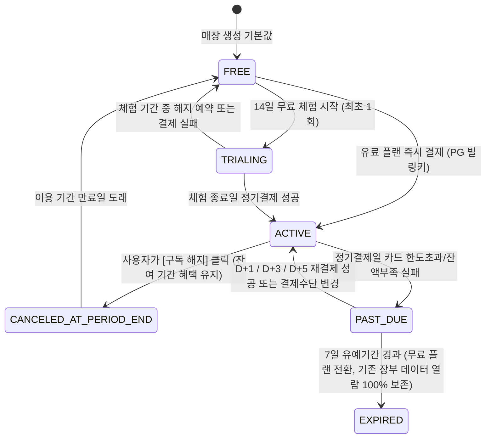

# 유료 멤버십(Free / Plus / Pro / Enterprise) 구독 및 결제 정산 설계서

**문서 ID**: COMM-MEM-002  
**관련 조항**: 제16조, 제20조(Subscription API)

---

## 1. 멤버십 상태 머신 (Subscription Lifecycle State Machine)

---

## 2. 소비자 보호 및 환불 정산 규칙

- **데이터 인질극(Data Lock-in) 절대 금지**: 유료 구독이 해지되거나 `EXPIRED`되어 무료 플랜으로 전환되더라도, 과거에 수집·입력된 매출·비용·세무 원장 데이터의 조회 및 엑셀 내보내기 권한은 영구히 보장한다.
- **청약철회 및 일할 환불**: 결제 후 7일 이내에 유료 전용 기능(미입금 상세 진단 내보내기, 마켓 쿠폰팩 사용 등) 사용 이력이 없으면 100% 전액 즉시 환불하며, 사용 이력이 있거나 7일 경과 시 잔여 일수 일할 계산 환불 공식을 투명하게 표시하고 처리한다.
