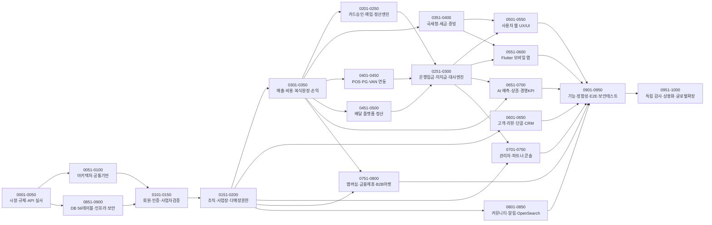

# 1,000개 Work Order 의존성 그래프 및 병렬 실행 토폴로지 (DAG Dependency Graph)

**문서 ID**: WO-DAG-002  

---

## 1. 도메인 대역 간 위상 정렬(Topological Sort) 의존성 다이어그램

---

## 2. 외부 API 미승인(Blocked) 시 무중단 우회 실행 규칙 (Non-Blocking Execution Rule)

제25조 원칙("미확보 외부 데이터 연동 때문에 전체 플랫폼이 영원히 진행 불가능한 구조를 만들지 않는다")에 따라:
- `WO-MOS-0201~0250`(카드), `WO-MOS-0251~0300`(은행 대사), `WO-MOS-0351~0400`(홈택스), `WO-MOS-0451~0500`(배달) 대역의 각 Work Order는 **Level 1(수기 입력) + Level 2(공식 엑셀/CSV 업로드 파서) + Level 3(표준 인터페이스 및 계약 테스트)**를 먼저 100% 완성하여 후속 대사 엔진과 웹/모바일 UI 개발이 블로킹 없이 완료되도록 설계되어 있다.
